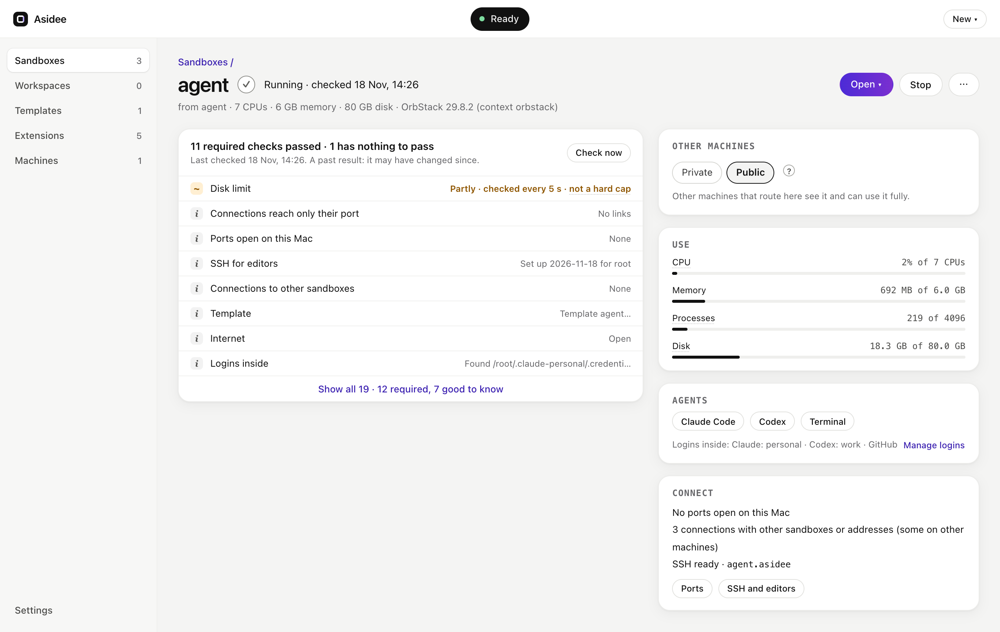
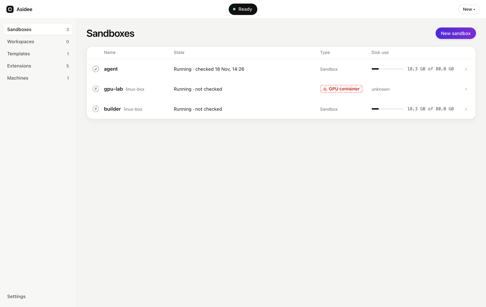
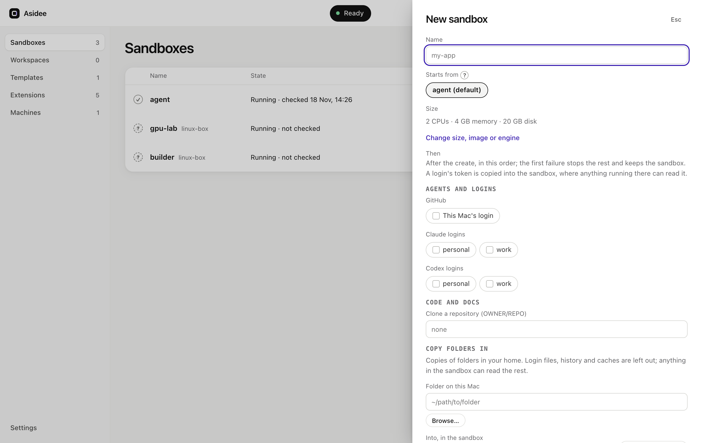
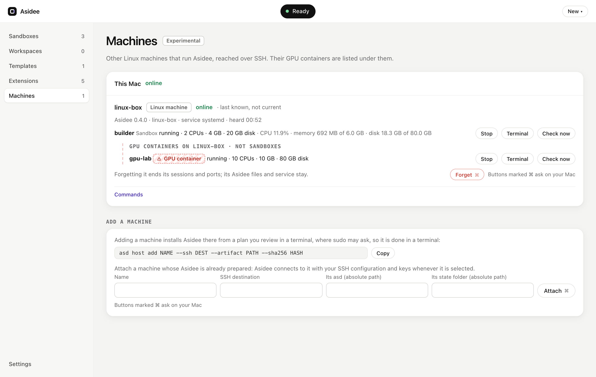

# Asidee

Sandboxes for coding agents that are checked instead of assumed.

> [!WARNING]
> **Early alpha (0.4.0).** Expect rough edges and breaking changes. The structure is in place and one engine works end
> to end: [OrbStack](https://orbstack.dev) with gVisor on a Mac, with Linux machines as an experimental extra.

"Asidee" (Agent Sandbox IDE) is a working name.



## What it does

- **Checked sandboxes.** `asd create demo` makes a sandbox on an isolated kernel and runs a fixed checklist against it:
  no host folders, no reach to the host, other sandboxes or your network, limits that hold. A sandbox that fails a
  required check does not run, and the daemon keeps checking while it runs.
- **Agents ready to work.** Start from a template with Claude Code and Codex, copy in logins, clone a repository and
  copy folders in, in one step.
- **Reach only what you name.** Forward one port to your Mac, link one sandbox to one port of another, or reach a
  virtual machine or a sandbox on another machine, without sharing a network.
- **A dashboard, a CLI and extensions.** Everything the dashboard does, `asd` does too, with `--json`.

## The dashboard

`asd ui --open` opens it in a browser. Your sandboxes, and the ones your other machines share, each tagged with its machine:



A new sandbox starts from a template, then can copy in logins, clone a repository and copy folders in:



Other Linux machines that run Asidee, reached over SSH, with their sandboxes and GPU containers:



The screenshots use demo names.

## Quick start

You need [Bun](https://bun.sh) and, on a Mac, [OrbStack](https://orbstack.dev). `nix develop` gives you Bun if you use Nix.

```sh
bun install
bin/asd setup                  # once, on a Mac: give the engine gVisor and prove it
bin/asd create demo
bin/asd shell demo
bin/asd ui --open              # the dashboard
bin/asd remove demo --confirm demo
```

Every command takes `--help`. [Getting started](docs/getting-started.md) has the details.

## Documentation

| | |
|---|---|
| [Getting started](docs/getting-started.md) | Setup, Docker inside a sandbox, logs, building and testing |
| [What Asidee does](docs/features.md) | The checklist and every feature built so far, with its limits |
| [macOS workspaces](docs/workspaces.md) | Folders on the Mac for work that needs its GPU; not sandboxes |
| [Customizing](docs/customizing.md) | How it is put together, extensions, your own dashboard, logins, how it is measured |
| [Other machines](docs/host-enrollment.md) | Adding a Linux machine |
| [Architecture](docs/architecture.md) | The design, and where the guarantees end |
| [Scorecards](evals/SCORECARD.md) | What was measured, on [Mac](evals/SCORECARD.md) and [Linux](evals/SCORECARD.linux.md) |
| [Agent skill](skill/SKILL.md) | Instructions for an AI agent that operates or customizes Asidee |
